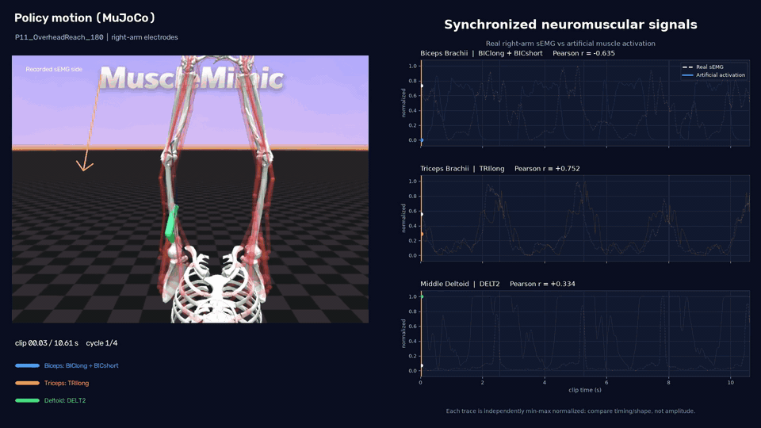
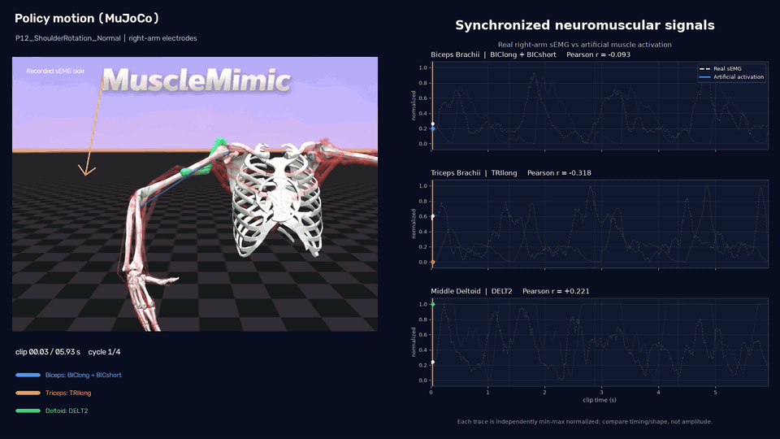
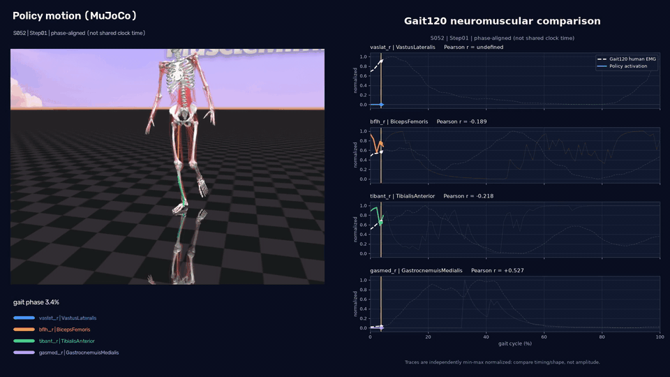

# mm-kit

<p align="center">
  <a href="LICENSE"></a>
  <a href="https://arxiv.org/abs/2603.25544"></a>
</p>

`mm-kit` is the evaluation benchmark for MuscleMimic policies. It compares
rollout NPZ files with recorded human data at three physiological levels:

- kinematics: joint-angle RMSE and waveform correlation;
- kinetics: joint-moment and vertical-GRF RMSE and waveform correlation; and
- neuromuscular behavior: muscle-activation correlation and muscle RSA against
  human EMG.

The benchmark produces population and subject-matched metrics, human reference
baselines, statistical reports, figures, and exclusion audits.

## Supported datasets

| Dataset | Evaluation | Analysis unit |
|---|---|---|
| Gait120 | Joint angles, joint moments, vertical GRF, muscle activation, and EMG | Subject and gait cycle |
| Wang | Joint angles, muscle activation, and EMG | Population gait profile |
| ULTra-MoCap | Arm kinematics, muscle activation, and EMG | Subject, movement, and trial |

Gait120 provides all three evaluation levels over one retained subject cohort.

## Install

Create a Python 3.11 environment and install the package from the repository
root:

```bash
uv venv --python 3.11
uv pip install --python .venv/bin/python -e .
```

Synchronized visualization requires the `render` extra:

```bash
uv pip install --python .venv/bin/python -e '.[render]'
```

## Configure data paths

```bash
mm-kit paths set gait120 /absolute/path/to/Gait120
mm-kit paths set wang /absolute/path/to/Wang
mm-kit paths set ultra-mocap /absolute/path/to/ULTra-MoCap
mm-kit paths show
```

An explicit `--dataset_dir` on an evaluation command overrides the saved path.

## Define policies

Evaluation commands accept a YAML file containing one or more rollout exports:

```yaml
policies:
  - id: policy-a
    label: "Policy A"
    trajectory_data_path: trajectory_data/policy-a/episodes.npz
    color: "#2a78d6"
    linestyle: "-"
```

The rollout `motion_group` and `traj_id` values determine subject and trial
identity. Compared policies must use the same ordered references.

## Evaluate

### Gait120

```bash
mm-kit evaluate gait120 \
  --motion_group GAIT120_TESTING \
  --policy_config_file policies.yaml \
  --plots_dir results/gait120 \
  --kinetics_reference_dir /path/to/gait120-kinetics
```

`--kinetics_reference_dir` enables the kinetics layer. The rollout NPZ provides
policy joint-force and foot-contact-force signals. Human joint moments come
from inverse dynamics; human GRF comes from corrected Gait120 force-plate
measurements.

### Wang

```bash
mm-kit evaluate wang \
  --policy_config_file policies.yaml \
  --plots_dir results/wang
```

### ULTra-MoCap

```bash
mm-kit evaluate ultra-mocap \
  --motion_group ULTRA_MOCAP_BIMANUAL_TESTING_SUBJECTS \
  --policy_config_file policies.yaml \
  --plots_dir results/ultramocap
```

Each run requires an empty output directory. Dataset-specific options are
available through:

```bash
mm-kit evaluate --list-datasets
mm-kit evaluate gait120 --help
mm-kit evaluate wang --help
mm-kit evaluate ultra-mocap --help
```

## Outputs

Evaluation outputs include:

- population and subject-matched metric tables;
- waveform and summary figures;
- paired Wilcoxon reports with Holm correction;
- retained-subject and exclusion audits; and
- run manifests where the workflow provides them.

Gait120 kinetics writes `kinetics_profiles.svg`, `kinetics_metrics.svg`,
`kinetics_metrics.csv`, and `kinetics_input_omissions.csv`.

Each dataset command documents its complete configuration through `--help`.
Input archives are validated before analysis starts.

## Synchronized visualization

Renderers synchronize policy motion with human and artificial muscle signals:

```bash
mm-kit render gait120 --help
mm-kit render ultra-mocap --help
```

## Demos

### Overhead reach (`P11_OverheadReach_180`)



### Shoulder rotation (`P12_ShoulderRotation_Normal`)



### Gait step (`S052_step01`)



## Add a dataset

Dataset adapters declare their source contract, workflow, CLI entrypoint, and
tests. Keep dataset files outside the repository and document their license and
access requirements.

External packages register adapters in `pyproject.toml`:

```toml
[project.entry-points."mm_kit.datasets"]
example = "example_package.cli:main"

[project.entry-points."mm_kit.renderers"]
example = "example_package.render:prepare_clip"
```

Validation should cover a minimal valid dataset, malformed inputs, alignment,
normalization, metrics, registry discovery, and an end-to-end run. The
[architecture guide](ARCHITECTURE.md) defines the extension boundaries.

## Development

```bash
make install-dev
make format
make lint
make test
make precommit
```

Ruff and pre-commit cover every Python file in the repository.

See [Architecture](ARCHITECTURE.md) for data flow, module ownership, input
contracts, and public extension points.

## Citation

```bibtex
@article{Li2026MuscleMimic,
  title={Towards Embodied AI with MuscleMimic:
    Unlocking full-body musculoskeletal motor learning at scale},
  author={Li, Chengkun and Wang, Cheryl and Ziliotto, Bianca and
    Simos, Merkourios and Kovecses, Jozsef and Durandau, Guillaume and
    Mathis, Alexander},
  journal={arXiv preprint arXiv:2603.25544},
  year={2026}
}
```
